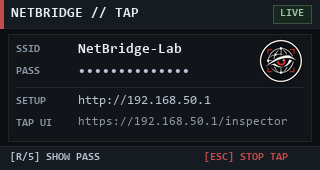
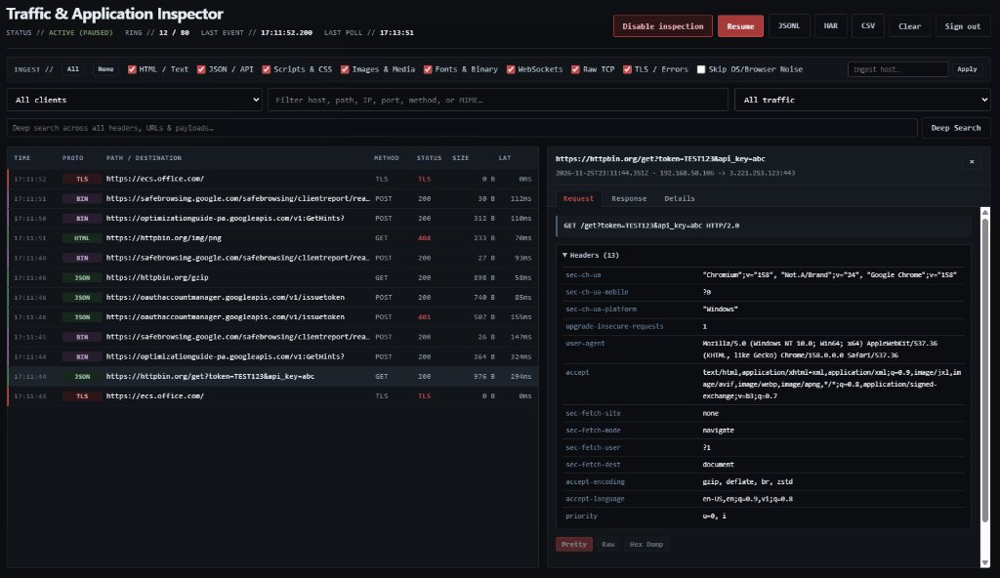

<p align="center">
  
</p>

<h1 align="center">NetBridge</h1>

<p align="center">A portable Wi-Fi Network Tap and transparent traffic inspector for the M5Stack Cardputer Zero.</p>

NetBridge turns a Cardputer Zero into a pocket-sized **inline Wi-Fi Network Tap** for inspecting and understanding the traffic of the devices and software you use. Launch it from APPLaunch to bring up an isolated Wi-Fi tap bridged to Ethernet; press **ESC** to shut down all NetBridge services and restore your previous Wi-Fi. It stays off at boot and leaves the stock desktop, launcher, and audio untouched.

<p align="center">
  
</p>

<p align="center">
  
</p>

## Highlights

- **Unredacted, memory-bounded visibility**: Unredacted, memory-bounded application traffic inspection, with explicit indicators for partial and streamed payloads.
- **Server-enforced export confirmation**: Authenticated `JSONL`, `HAR`, `CSV (Safe)`, `CSV (Raw)`, raw payload, and hex exports warn in the UI and require explicit server-side confirmation (`confirm=unredacted`).
- **Capture Ingest Filters & Noise Control**: Toggle 8 traffic categories (`HTML / Text`, `JSON / API`, `Scripts & CSS`, `Images & Media`, `Fonts & Binary`, `WebSockets`, `Raw TCP`, `TLS / Errors`), filter by `Ingest host…`, or enable **Skip OS/Browser Noise** inside `mitmdump` *before* payloads are read or stored.
- **Deep Search & Encrypted Browser Archive**: Search on-demand across all headers, URLs, and payloads (`/api/flows-search`), with `sessionStorage` offline fallback and an opt-in **Browser Archive** (`IndexedDB`) encrypted with a RAM-only non-extractable `AES-256-GCM` key (auto-purged on load, sign-out, expiry, or clear, with a persistent warning banner while data is stored).
- **Opt-in & Fail-open**: Uses a persistent device-local RSA-2048 CA (`/trust`), per-client approval expiring on disconnect (`/admin`), and automatic `nftables` fail-open pass-through if `netbridge-proxy.service` stops.
- **Tuned for 352 MiB RAM**: Bounded `100`-flow / `6 MiB` ring, bounded `zlib`/`zstd` decompression, `64 KiB` HTTP previews, and a one-shot framebuffer screen (`[R/5]` toggles password visibility).

## Capture Limits, Scope & Export Policy

NetBridge records unredacted traffic within fixed memory bounds suited to the Cardputer Zero (`352 MiB` RAM):

- **Ring & storage**: Up to `100` retained flows and `6 MiB` total staged/ring storage (`MAX_FLOWS = 100`, `MAX_FLOW_STORAGE_BYTES = 6 MiB`), with oldest entries evicted when full.
- **HTTP payloads**: `64 KiB` (`65536` bytes) retained per request/response body (`32 KiB` inline preview in the browser); `mitmdump` streams bodies over `512 KiB` (`streamed` status).
- **Compressed payloads**: Decompression is bounded (`256 KiB` max compressed input, `2 MiB` `zstd` decoder window). Truncated or unsupported encodings (`br`, oversized, or malformed) report `decoded_size_known: false` instead of guessing an exact decoded size.
- **WebSocket & TCP streams**: Up to `32 KiB` (`32768` bytes) retained per direction and `128` frame/chunk metadata entries; connections exceeding `128` messages report `partial` status with `total_messages`, `retained_messages`, and `omitted_messages`.
- **Headers & URLs**: Up to `96` headers per message (`2048` chars/value) and `2048` chars per URL.
- **Protocol coverage & fail-open**: Captures HTTP, HTTPS (for trust-confirmed, approved clients), WebSockets, raw TCP, and TLS/connection errors. UDP/QUIC (`443/udp`) is blocked for inspected clients so browsers fall back to TCP/TLS. If `netbridge-proxy.service` stops or fails consecutive local `/__netbridge_healthz` checks, `nftables` redirection is flushed automatically.
- **Capture loss accounting**: The inspector `LOSS //` indicator and exported metadata track observed, retained, intentionally filtered, evicted, queue-dropped, stage-dropped, worker-error, and IPC-failure counts.
- **Exports**:
  - `JSONL` is the canonical lossless-within-bounds export format.
  - `HAR` exports only HTTP/HTTPS flows (`timings` fields unavailable from `mitmdump` are `-1`) and includes `_netbridge` completeness metadata.
  - `CSV (Safe)` escapes leading spreadsheet formula characters (`=`, `+`, `-`, `@`, `\t`, `\r`); `CSV (Raw)` preserves exact captured values (open raw CSVs only in trusted tools, not directly in spreadsheet apps).
  - Bulk exports and raw/hex downloads require explicit `confirm=unredacted` (or `X-NetBridge-Confirm-Export: unredacted`).

## Quick Install (via SSH)

Review the source and network policy before installing on a device you own or are authorized to administer. Over Ethernet SSH on the Cardputer Zero:

```sh
git clone https://github.com/adversaryicu/Netbridge.git
cd Netbridge
chmod +x install.sh
sudo ./install.sh --apt
```

`install.sh` checks prerequisites (`--apt` installs missing Debian packages), runs the test suite, configures the `netbridge-ap` NetworkManager profile (generating a `Noun-Noun-4Digit` Wi-Fi passphrase), provisions `/usr/local/lib/netbridge/mitm-venv` (`mitmdump`), compiles the native watchdog, and adds **NetBridge** to APPLaunch.

1. Open **NetBridge** from APPLaunch (press **`R`** or **`5`** to reveal the Wi-Fi password).
2. Connect your test device, open `http://192.168.50.1/`, install the CA, and verify trust over HTTPS.
3. Pair the administrator account at `https://192.168.50.1/admin`, approve the client, and enable inspection.
4. Inspect live traffic at `https://192.168.50.1/inspector`. Press **ESC** on the Cardputer to stop.

### Update, Status & Uninstall

```sh
sudo ./install.sh update             # Pull latest, test, update code/units (preserves config & CA)
sudo ./install.sh status             # Show install state, services, and CA fingerprint
sudo ./install.sh uninstall          # Remove services/app (retains CA & config)
sudo ./install.sh uninstall --purge  # Remove everything including CA, admin, and service users
```

## Security & Distribution

- **Authorized use only**: Device-local secrets (CA private key, Wi-Fi passphrase, admin credentials) never leave the device; NetBridge does not bypass certificate pinning or silently install CAs.
- **Why GitHub over SSH**: Inline `nftables` redirection (`CAP_NET_ADMIN`) and `NetworkManager` AP control require elevated network privileges, which conflicts with the Cardputer Store's non-root app rule.

## License

NetBridge is available under the [PolyForm Noncommercial License 1.0.0](LICENSE) (noncommercial use only).
